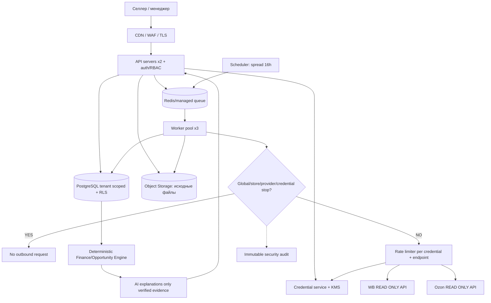

# AI Profit Office — архитектура на 1 000 пользователей

**Версия:** 0.3.1 / план расширения. **Статус:** архитектурный проект, не развернутая SaaS-инфраструктура.

## Нагрузка — исходные гипотезы

- 1 000 платящих пользователей — **не равно** 1 000 магазинам и 1 000 токенам.
- Три сценария: Light — 1 000 подключений, Base — **1 400**, Heavy — 2 000. Если один кабинет требует разных ключей finance/ads — **число credentials выше числа магазинов**.
- Base: 12 логических групп данных на кабинет в сутки × 3 страницы на группу → **50 400 внешних API-запросов/сутки** (1,512 млн/мес.).
- Распределяем выполнение по окну **16 часов**, чтобы избежать утреннего шторма: **0,875 запроса/сек в среднем** и условно **5,25 запроса/сек** при пиковом коэффициенте 6. Это **общая** скорость между всеми кабинетами; ограничения конкретного метода конкретного магазина могут быть гораздо ниже.
- В Base при 80 КБ/ответ, компрессии 35% от оригинала и хранении raw 90 дней объём около **127 ГБ** (не считая индексов, parsed ledger, бэкапов и файлов импорта). Размер ответов и степень сжатия — предположения.
- Сценарии воспроизводятся: `python scripts/capacity_plan.py` и в `Infrastructure_Capacity_1000_Users.xlsx`.

## Целевая топология (production, НЕ текущий pre-alpha)

## Компоненты для планирования

| Слой | Рекомендованный старт при Base | Масштабирование / защита |
|---|---|---|
| API/Web | 2 экземпляра × 2 vCPU / 4 ГБ, behind reverse proxy | Горизонтальное масштабирование, auth/MFA, WAF; separate admin surface |
| Workers | 3 экземпляра × 2 vCPU / 4 ГБ | Отдельные пулы WB/Ozon и financial; fair-share per tenant; hard cap |
| PostgreSQL | Managed HA: 2 узла × 2 vCPU / 8 ГБ, от 100 ГБ SSD | Индексы tenant/date/provider/event; PITR; проверка RLS; read replicas по факту |
| Redis/Queue | 1 managed service + durable jobs в PostgreSQL | Redis не источник истины stop-флагов; lease/fencing; consumer retries |
| Object Storage | ~130 ГБ raw/90d Base + рост и backups | Encryption at rest, lifecycle 30/90d, separate raw/normalized |
| Secrets/KMS | Envelope encryption; multi-region key management by policy | Ключи не попадают в LLM, аналитику, логи, браузер или очередь |
| Audit/Monitoring | SLO + error budget; cost/tenant | Emergency stops, audit events and alerts; backup restores |

### Очередь и ограничения WB/Ozon

- Задание **(tenant, store, provider, endpoint, window, page_cursor)**; sync cursor + watermark; idempotency key. Новые финансовые события — append-only, а пересчёты выделены.
- Token bucket **на каждую комбинацию кабинет+endpoint**, плюс при необходимости shared category/marketplace limit. Документированные лимиты для разных endpoint отличаются, поэтому **никакой один глобальный RPS не считается разрешённым лимитом площадки**.
- HTTP 429: Retry-After (если получен), exponential backoff + jitter, circuit breaker, прекратить повторную синхронизацию при повторном отказе/отзыве доступа.
- Zero trust: диспетчер задач не содержит key в payload; worker получает credential только непосредственно перед вызовом через vault.
- Пауза/отзыв **останавливает новые вызовы**; начатые запросы могут завершиться. Для аварии уровня компрометации: блокировать исходящий сетевой трафик connector workers и **отозвать исходный ключ в кабинете WB/Ozon**.
- Не смешивать события продаж, выплаты, начисления и возвраты; независимая reconciliation; наличие ключа не означает полную финансовую достоверность.

## Tenant boundary / роли

- `tenant_id` в каждой финансовой таблице, `store_id` и `credential_id` scoped by tenant.
- RBAC: owner, manager, auditor; приглашение и отзыв разрешений; менеджеру доступ только к явно разрешенным магазинам.
- PostgreSQL Row Level Security + контроль через application tenant context, независимые сервисные роли и тесты cross-tenant. Не доверять tenant_id, переданному клиентским JS.
- При компрометации одного магазина токены остальных должны оставаться работоспособными. Системный стоп выше store и provider.
- Ключи для WB и Ozon **только READ ONLY**, насколько это позволяет модель разрешений API. Не запрашивать изменения цен/рекламы/остатков.

## Нагрузка и SLO для проверки

- Начальные целевые SLO (не достигнутые): 95% API ответов веб-приложения ≤500 мс на прогретом кэше; 95% фоновых синхронизаций не позднее согласованного окна; 0 доступа к чужим данным; 100% учтённых применений kill-switch.
- Для пилота 3 кабинета → затем 20 → 100 → 300 → 1 000: нагрузочное тестирование с mock API, тесты конкурентных stop, fault injection, restore testing, per-endpoint throttling, quota alarms.
- SQLite и локальный key file версии 0.3.1 **не подходят** для хостинга 1 000 клиентов. Они нужны только для локального безопасного теста с тремя кабинетами.

## Отдельно: регион и требования

Где хранить финансовые/персональные данные и ключи клиентов — определить до SaaS-публикации с учётом применимого права РФ/РК, договоров WB/Ozon, категории данных, согласий и доступности провайдера. Не отправлять идентификаторы покупателей и секреты LLM-провайдеру без законных оснований и строгой минимизации.
