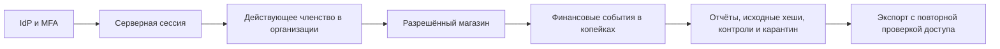

# RFC L04 · объединение финансов и кабинетов

Предложение на ревью двух партнёров. Старое приложение и lab остаются
локальными, а публичный запуск v0.3.7 заблокирован.

Личность определяют проверенные issuer + subject. Сервер проверяет audience,
срок действия, подпись, MFA и отзыв. Идентификаторы клиента из запроса выбирают
ресурс. Источником полномочий остаётся текущее членство на сервере. Owner
управляет магазинами и доступом, manager работает только с назначенными
магазинами, auditor читает разрешённые данные. Выдача экспорта требует отдельного
разрешения. Worker использует отдельную служебную роль и проверяет членство,
store scope и stop перед dispatch, retry и commit.

Репозиторий открывает транзакцию с tenant/store контекстом. Ключи и внешние
ссылки tenant-scoped, RLS действует для чтения и записи. Сессии обновляются после
входа или повышения привилегий. Отзыв и восстановление инвалидируют старые
сессии. Для выгрузок проверка повторяется на create/status/download/renew.

Запрещены обходы через прямую публикацию v0.3.7, перенос lab-cookie, доверие к
заголовку с ролью или tenant, фоновые задания с бессрочной авторизацией, доступ
runtime от владельца таблиц и SQL вне scoped транзакции. API, worker и backup
не получают права расшифровки реальных токенов. Это право проектируется только
для connector workload identity.

Миграция начинается с вымышленных организаций и копии синтетического SQLite.
Хеши, исходные строки, версия контракта, независимые контроли, связки
отчёт–событие, копейки, партии и записи карантина сравниваются до и после.
Незнакомые записи остаются в карантине. Отдельно проверяются конфликт
идентификаторов, повтор запуска и откат на новую базу. Исходную базу
сохраняют в неизменном виде. Контуры переключаются только после нового набора
отрицательных тестов и ревью Партнёра А по финансовому паритету.
