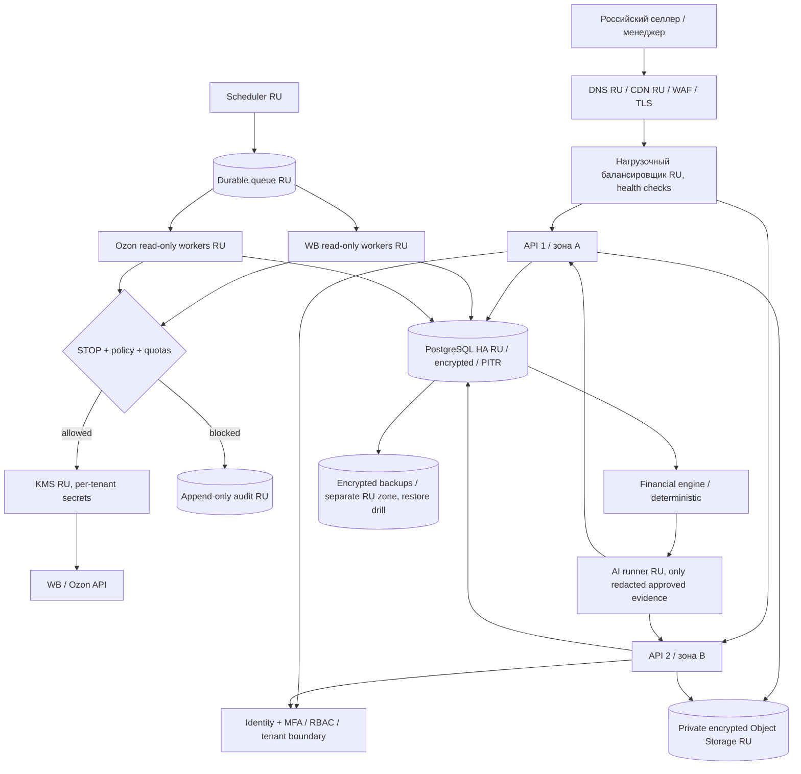

# AI Profit Office — целевая архитектура РФ (v0.3.3: проект, НЕ развёрнута)

**Рынок:** Россия, 1 000 активных подписчиков, модель 1–2 магазина на человека. Все персональные данные граждан РФ, относящиеся к продукту, обрабатываются в рамках законно выбранной российской инфраструктуры. **Эта схема не подтверждает соответствие 152-ФЗ.**

## Российская доступность

- **Web/UI:** все критически важные шрифты, CSS, JS и captcha — самохостинг/поставщики с проверенной доступностью из РФ; не зависеть от CDN, зарубежной аналитики и обязательного зарубежного LLM на критическом пути.
- **Регион:** указать *фактический* российский регион для compute, PostgreSQL, key management, queue, object storage, backup, logs, telemetry, AI processing. Запросить адреса, условия договора/обработки и документальное подтверждение места размещения.
- **Доступ при деградации WB/Ozon:** UI открывается; данные помечены `последняя синхронизация`, `задержка`, `полнота`, `ошибка источника`. Не выдавать старые данные за текущие; новая оценка «найденной экономии» блокируется при неполной сверке.
- **Два AZ:** минимум два экземпляра API в разных зонах; PostgreSQL HA по рекомендациям поставщика; отдельный план DR при общей региональной аварии. Не выдавать 2-AZ за защиту от полной аварии региона.
- **Очереди:** per-provider, per-tenant, per-endpoint budget + retry с jitter/backoff, дедупликация событий, dead-letter queue; при ошибке одного магазина другие продолжают синхронизироваться.
- **Безопасность:** сервисы могут обмениваться tenant-scoped ID, а не секретами. Kill-switch проверяется *перед каждым внешним вызовом*, в том числе после повторной выдачи задания.
- **RU Payments:** провайдер российской эквайринговой оплаты/чеков по итоговой юридической схеме; платёжные реквизиты хранит платёжный провайдер; в нашей БД только ID, статус и сведения, минимально необходимые для работы.

## Стартовая нагрузка — НЕ реальные измерения

| Параметр | Допущение |
|---|---:|
| Платящие пользователи | 1 000 |
| Подключённые магазины | 1 400 |
| API вызовов в сутки | 50 400 |
| API вызовов в месяц (30 дней) | 1 512 000 |
| Средний RPS за 16 часов импорта | 0,875 |
| Пиковый коэффициент | x6 (≈ 5,25 RPS суммарно) |
| Хранение сырых ответов за 90 дней | ≈127 GB (синтетические предположения) |

Суммарный RPS **не** равен допустимому лимиту отдельного метода и токена WB/Ozon. Точные лимиты проверяются непосредственно перед разработкой коннектора.

## Пошаговое масштабирование

- `0–3 магазина`: локальный research только, без публичных данных третьих лиц без правовой проверки.
- `3–20 магазинов`: российский тестовый контур с synthetic/pseudonymized data, воспроизводимость расчётов, тест интеграций.
- `20–100 магазинов`: Private Alpha с identity, MFA admin, tenant RBAC, KMS и юридическими документами.
- `100–300 магазинов`: HA two-AZ, load tests, резервное восстановление, мониторинг стоимости, очереди.
- `300–1000+ магазинов`: ограничения справедливости нагрузки, независимые пулы воркеров, failure injection, автоматизация инцидентов.

## SLA/SLO — цели, НЕ гарантии

- UI monthly availability target: 99.9% (приблизительно 43,2 минуты простоя за 30 суток).
- P95 HTTP API / cached: до 500 ms; финансовые отчёты асинхронно.
- Синхронизация «актуально»: индивидуально по источнику; желаемые окна, а не обещание мгновенной актуальности.
- RPO ≤15 мин, RTO ≤60 мин **только после испытаний резервного копирования**.
- 0 межклиентских доступов; 0 секретов в LLM, API ответах браузера и логах.

## Cloud provider

Yandex Cloud — кандидат; перепроверить регион, аттестацию, формулировку договора обработки и соответствие *конкретной конфигурации*, запросить цены/документы. Провести технико-экономическое сравнение с вторым российским провайдером. Использование аттестованного облака не делает SaaS автоматически аттестованным.
